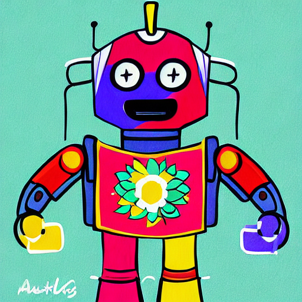
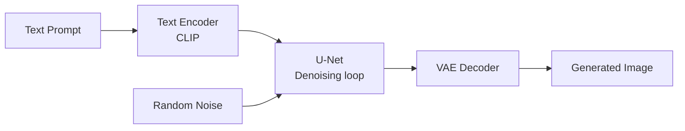
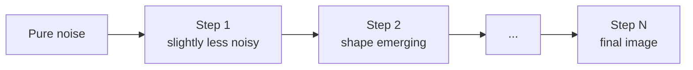
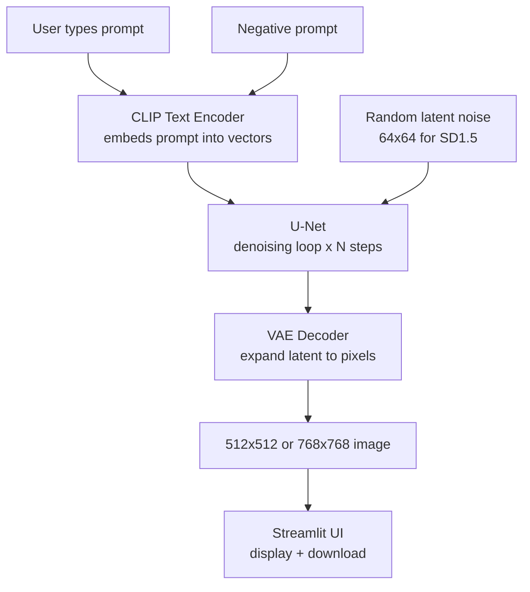

# Local Stable Diffusion — Offline Image Generator

This lab runs a fully offline AI image generator on your own machine using **Stable Diffusion**, **Hugging Face Diffusers**, and a **Streamlit** web UI.  
No cloud, no API key, no cost — everything stays on your laptop.

Supported hardware:
- **Apple Silicon Mac (M1/M2/M3/M4)**: uses Metal (MPS) GPU acceleration
- **Windows or Linux with an NVIDIA GPU**: uses CUDA. Needs about 4 GB of VRAM for SD 1.5 and 8 GB for SDXL.
- **CPU only** (any Windows laptop, Intel Mac): works, but slowly. Expect minutes per image instead of seconds. Use SD 1.5 only.

**Quick links:** [macOS / Linux setup](#setup--macos--linux) · [Windows setup](#setup--windows) · [Troubleshooting](#troubleshooting)

### Example output

<p align="center">
  
</p>

<p align="center"><em>Generated locally with this app at 512 × 512. No cloud service involved.</em></p>

---

## What is Stable Diffusion?

Stable Diffusion is a **text-to-image** deep learning model. You type a description (a *prompt*) and the model generates a matching image from random noise — entirely on your hardware.

### How it works — the three key components



| Component | What it does |
|-----------|-------------|
| **Text Encoder (CLIP)** | Converts your prompt into a list of numbers (embeddings) that capture meaning |
| **U-Net** | Runs the denoising loop — starts from pure noise and gradually refines it guided by the text embeddings |
| **VAE Decoder** | Converts the compressed latent representation back into a full-resolution pixel image |

### The denoising loop (inference steps)



Each step the U-Net predicts and removes a little noise, guided by your prompt.  
More steps = better quality but slower. Typical range: **20–50 steps**.

### Guidance Scale

The **guidance scale** (CFG scale) controls how strictly the image follows your prompt vs. being more creative.

| Value | Effect |
|-------|--------|
| 1 – 4 | Ignores prompt, very random |
| 7 – 9 | Good balance — recommended default |
| 12 + | Follows prompt very strictly, can look over-saturated |

---

## SD 1.5 vs SDXL — What is the difference?

| Feature | Stable Diffusion 1.5 | Stable Diffusion XL |
|---------|---------------------|-------------------|
| Release | 2022 | 2023 |
| Best resolution | 512 × 512 | 768 × 768 or higher |
| Model size | ~4 GB | ~7 GB |
| Speed on M-series | Fast | Moderate |
| Image quality | Good | Better detail and realism |
| Data type on MPS | **float32** (required) | float16 |

> **Why float32 for SD1.5 on MPS?**  
> Apple's Metal GPU uses float16 by default, but SD1.5's VAE decoder produces black images in float16 on MPS — a known upstream bug. Running in float32 fixes it. SDXL does not have this problem.

---

## Project Structure

```
sd/
├── sd_local.py          # Main Streamlit app
├── images/              # Example outputs for this README
├── sd15/                # Stable Diffusion 1.5 model (downloaded separately)
├── sdxl/                # Stable Diffusion XL model (downloaded separately)
└── README.md
```

The model folders (`sd15/`, `sdxl/`) are **not included** in the repo, because they're several gigabytes each. You download them once with the Hugging Face CLI. Run every command below from inside this `sd/` folder, because the app looks for `./sd15` and `./sdxl` relative to where you start it.

**Disk space:** about 6 GB for SD 1.5, plus 7 GB more for SDXL.

> **Download only the files the app needs.** The SD 1.5 repo on Hugging Face is over 40 GB, because it also holds several old single-file checkpoints. The `--include` filters below limit the download to about 5.5 GB.

> **The old `runwayml/stable-diffusion-v1-5` repo no longer exists.** Use `stable-diffusion-v1-5/stable-diffusion-v1-5`. Neither model below needs a Hugging Face login.

---

## Setup — macOS / Linux

### 1. Create a virtual environment

```bash
cd labs/5350/sd
python3 -m venv .venv
source .venv/bin/activate
```

Or with conda: `conda create -n sd python=3.11 -y && conda activate sd`

### 2. Install dependencies

```bash
pip install --upgrade pip
pip install torch
pip install "diffusers>=0.30,<0.36" "transformers>=4.42,<5" "huggingface_hub>=0.23,<1" accelerate safetensors scipy streamlit
```

> On Apple Silicon, the standard `pip install torch` already includes Metal (MPS) support, so you don't need a special build.
> On Linux with an NVIDIA GPU, use the CUDA command from the Windows section's step 3 instead.

### 3. Download the models

```bash
hf download stable-diffusion-v1-5/stable-diffusion-v1-5 --local-dir sd15 \
  --include "model_index.json" "scheduler/*" "tokenizer/*" "feature_extractor/*" \
  "text_encoder/config.json" "text_encoder/model.safetensors" \
  "unet/config.json" "unet/diffusion_pytorch_model.safetensors" \
  "vae/config.json" "vae/diffusion_pytorch_model.safetensors" \
  "safety_checker/config.json" "safety_checker/model.safetensors"
```

Optional, SDXL (about 7 GB, half-precision weights):

```bash
hf download stabilityai/stable-diffusion-xl-base-1.0 --local-dir sdxl \
  --include "model_index.json" "scheduler/*" "tokenizer/*" "tokenizer_2/*" \
  "text_encoder/config.json" "text_encoder/model.fp16.safetensors" \
  "text_encoder_2/config.json" "text_encoder_2/model.fp16.safetensors" \
  "unet/config.json" "unet/diffusion_pytorch_model.fp16.safetensors" \
  "vae/config.json" "vae/diffusion_pytorch_model.fp16.safetensors"
```

> If you have an older install where `hf` isn't found, use `huggingface-cli download` with the same arguments.

### 4. Run the app

```bash
streamlit run sd_local.py
```

A browser tab opens at `http://localhost:8501`. Type a prompt and click **Generate**.

---

## Setup — Windows

These steps use **PowerShell**. Open it from the Start menu, then `cd` to this folder.

### 1. Install Python

- Install **Python 3.11** (3.10–3.12 all work) from [python.org](https://www.python.org/downloads/windows/). **Don't use the Microsoft Store version**, because its sandboxed paths break large package installs.
- On the first installer screen, check **"Add python.exe to PATH"**.
- Check it worked:

```powershell
py -3.11 --version
```

### 2. Create and activate a virtual environment

```powershell
cd labs\5350\sd
py -3.11 -m venv .venv
.\.venv\Scripts\Activate.ps1
```

If PowerShell says *"running scripts is disabled on this system"*, allow scripts for your user account only, then activate again:

```powershell
Set-ExecutionPolicy -Scope CurrentUser -ExecutionPolicy RemoteSigned
.\.venv\Scripts\Activate.ps1
```

Your prompt should now start with `(.venv)`.

### 3. Install PyTorch

On Windows, the standard `pip install torch` gives you a **CPU-only** build, even if you have an NVIDIA GPU. Choose the command for your machine.

**NVIDIA GPU:** first check that the driver is working:

```powershell
nvidia-smi
```

If that prints a table showing your GPU, install the CUDA build:

```powershell
python -m pip install --upgrade pip
pip install torch --index-url https://download.pytorch.org/whl/cu126
```

**No NVIDIA GPU** (Intel/AMD graphics, most thin laptops):

```powershell
python -m pip install --upgrade pip
pip install torch --index-url https://download.pytorch.org/whl/cpu
```

Check which device PyTorch sees:

```powershell
python -c "import torch; print('CUDA available:', torch.cuda.is_available())"
```

`True` means GPU. `False` means CPU: the app still works, but use SD 1.5 at 512×512 with about 20 steps.

### 4. Install the other packages

```powershell
pip install "diffusers>=0.30,<0.36" "transformers>=4.42,<5" "huggingface_hub>=0.23,<1" accelerate safetensors scipy streamlit
```

### 5. Download the models

PowerShell doesn't accept `\` to continue a line, so these use a backtick (`` ` ``) at the end of each line instead. Keep the backtick as the **last** character on the line, with no space after it.

```powershell
hf download stable-diffusion-v1-5/stable-diffusion-v1-5 --local-dir sd15 `
  --include "model_index.json" "scheduler/*" "tokenizer/*" "feature_extractor/*" `
  "text_encoder/config.json" "text_encoder/model.safetensors" `
  "unet/config.json" "unet/diffusion_pytorch_model.safetensors" `
  "vae/config.json" "vae/diffusion_pytorch_model.safetensors" `
  "safety_checker/config.json" "safety_checker/model.safetensors"
```

Optional, SDXL (NVIDIA GPU with 8 GB+ VRAM only, too slow on CPU):

```powershell
hf download stabilityai/stable-diffusion-xl-base-1.0 --local-dir sdxl `
  --include "model_index.json" "scheduler/*" "tokenizer/*" "tokenizer_2/*" `
  "text_encoder/config.json" "text_encoder/model.fp16.safetensors" `
  "text_encoder_2/config.json" "text_encoder_2/model.fp16.safetensors" `
  "unet/config.json" "unet/diffusion_pytorch_model.fp16.safetensors" `
  "vae/config.json" "vae/diffusion_pytorch_model.fp16.safetensors"
```

> Using **Command Prompt (cmd.exe)** instead of PowerShell? Put the whole command on one line, or end each line with `^` instead of a backtick.

### 6. Run the app

```powershell
streamlit run sd_local.py
```

A browser tab opens at `http://localhost:8501`. The first image takes longer, because the model loads into memory.

### Windows tips

- **Keep the project in a short path** such as `C:\labs\MNIST`. Deep folders inside OneDrive (`C:\Users\<you>\OneDrive\Documents\...`) can hit Windows' 260-character path limit, and OneDrive tries to sync the multi-GB model files.
- **Next time**, you only need to `cd` to the folder, run `.\.venv\Scripts\Activate.ps1`, then run `streamlit run sd_local.py`.
- When Windows Defender Firewall asks about Python, you can click **Cancel**. The app only needs `localhost`.

---

## Memory Optimizations

Large models can exceed available GPU memory. The app automatically enables three techniques:

| Technique | What it does |
|-----------|-------------|
| `enable_attention_slicing()` | Computes attention in smaller chunks — trades speed for memory |
| `enable_vae_tiling()` | Decodes the image in tiles instead of all at once |
| `enable_sequential_cpu_offload()` | Moves model layers to CPU when not in use, then back to GPU |

If you still run out of memory:
1. Reduce image resolution (e.g. 512×512 instead of 768×768)
2. Reduce inference steps (e.g. 20 instead of 50)
3. Switch from SDXL to SD1.5

---

## Prompt Tips for Students

A good prompt has three parts:

```
[subject], [style/medium], [quality boosters]
```

**Example:**
```
a golden retriever in a sunflower field, oil painting, highly detailed, warm lighting, 4k
```

**Negative prompt** — tell the model what to avoid:
```
blurry, low quality, distorted, extra limbs, watermark
```

| Prompt element | Example |
|---------------|---------|
| Subject | `a medieval castle`, `a robot chef` |
| Style | `photorealistic`, `watercolour`, `pencil sketch`, `anime` |
| Lighting | `golden hour`, `dramatic lighting`, `soft studio light` |
| Quality | `highly detailed`, `sharp focus`, `8k`, `award winning` |
| Negative | `blurry`, `ugly`, `deformed`, `low resolution` |

---

## Troubleshooting

**Black or very dark images**  
Only affects SD1.5 on Apple Silicon. The app already forces `float32` to fix this. If you see it, check that you are using `sd_local.py` from this repo and not a custom script.

**Out of memory error**  
Lower the resolution or step count first. If the error persists, restart the app — MPS memory is not always released between runs. The app calls `torch.mps.empty_cache()` automatically, but a full restart is sometimes needed.

**`FileNotFoundError` for model directory**  
Either the model wasn't downloaded, or you started Streamlit from a different folder. `cd` into `sd/` (the folder containing `sd15/`) and run `streamlit run sd_local.py` again.

**`ModuleNotFoundError: No module named 'diffusers'`**  
Your virtual environment isn't active, or Streamlit is running from a different Python. Activate the venv, then run `python -m streamlit run sd_local.py`. That guarantees Streamlit uses the venv's Python.

**App crashes on start with `Segmentation fault` (macOS/Linux) or exits silently**  
This happens when TensorFlow is installed in the same environment, as it is in Anaconda's base env: `transformers` tries to load TensorFlow and crashes. `sd_local.py` sets `USE_TF=0` to prevent it. If you still see the crash, use a fresh venv as described above.

**404 / `Repository Not Found` when downloading**  
You're using the old `runwayml/stable-diffusion-v1-5` name. Use `stable-diffusion-v1-5/stable-diffusion-v1-5`.

**Download is 40 GB+ / disk full**  
You left out the `--include` filters. Delete the `sd15` folder and re-run the command exactly as shown.

**Streamlit port already in use**  
```bash
streamlit run sd_local.py --server.port 8502
```

### Windows-specific

**Device shows `CPU` even though I have an NVIDIA GPU**  
You installed the CPU build of PyTorch. Reinstall the CUDA build:
```powershell
pip uninstall -y torch
pip install torch --index-url https://download.pytorch.org/whl/cu126
```
If `torch.cuda.is_available()` is still `False`, update your NVIDIA driver and check that `nvidia-smi` works.

**`OSError: [WinError 126]` or `DLL load failed` when importing torch**  
Install the [Microsoft Visual C++ Redistributable (x64)](https://aka.ms/vs/17/release/vc_redist.x64.exe), then open a new PowerShell window.

**`CUDA out of memory`**  
Use SD 1.5 at 512×512 and close other GPU-heavy apps such as games or browsers with many tabs. GPUs with 4 GB or less may only manage 512×512.

**`hf` / `streamlit` is not recognized**  
The venv isn't active: run `.\.venv\Scripts\Activate.ps1`. For Streamlit, `python -m streamlit run sd_local.py` also works.

**`OSError: [Errno 2]` / path too long while installing**  
Move the project to a short path such as `C:\labs\MNIST`, recreate the venv, and install again.

---

## Architecture — Full Pipeline



---

## Ideas for Extension

The app is intentionally minimal. Try extending it:

- **Img2Img** — start from an existing image instead of pure noise
- **Inpainting** — mask part of an image and regenerate just that region
- **LoRA loading** — plug in a small fine-tuned adapter to change the art style
- **Prompt enhancement** — pass the prompt through a local LLM (Ollama) before sending to SD
- **Batch generation** — generate multiple images in one run and compare them
- **SDXL Refiner** — run a second refinement pass for sharper detail

---

## License

Code in this lab: MIT License.  
Model weights: each model has its own licence on Hugging Face — check before commercial use.
